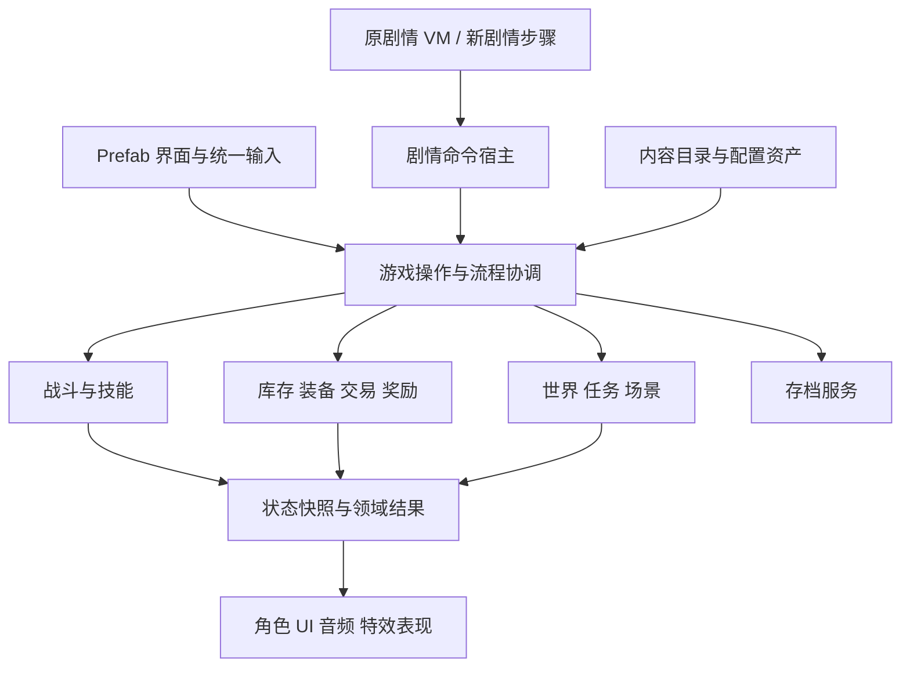

# 古剑魂梦：还原与持续开发技术方案

日期：2026-10-30。根据本次需求，以用户提供的安装包还原游戏，并将工程建设为可持续开发的基础；允许更换过时的实现方案。本方案更新此前“优先验收现有移植版本”的交付范围。

## 目标与依据

交付应同时满足两件事：原有内容能够正常游玩；开发者能够通过稳定的模块、原生资产和编辑工具继续增加内容。

原版依据是 `E:\qqhuancun\古剑魂梦-天剑奇侠.1`。本次静态核验结果：

- 文件为 APK/ZIP，大小 4,665,752 字节。
- SHA-256：`44100d1dbbda773f229fa15e89e7e49e6c9c5d1de644db796a0473c50f010559`。
- 与 `Reference/inventory.json` 的源包哈希一致，包内全部 2,323 个文件的大小和 SHA-256 均与清单一致。
- Android 包名 `com.ty.jl`，版本 `1.0` / code `1`，标题“古剑魂梦-天剑奇侠”，入口 `com.dobetter.client.JL01Activity`，最低 SDK 记录为 7。

因此可复用已有资源提取、反编译参考和 Unity 资产。来源一致只证明基线身份，不能证明现有 Unity 玩法与原版完全一致。本次评估未主动启动原 APK 或 Unity，也未执行编译、游玩或 Android 构建验收；逐项证据见 `Validation/source-package-baseline-2026-10-30.json`。

暂按现有单机玩法、Android 为首要运行平台、Windows 为开发与游玩验证平台设计。后续原创内容的具体数量和新机制不计入本次基础工程估算。

## 还原的验收边界

| 内容 | 验收要求 |
| --- | --- |
| 剧情、人物、地图、任务和主要美术 | 以源包为依据，保留原内容及关联关系；缺失资料明确标记 |
| 战斗、装备、强化、剑灵、经济与奖励 | 先建立原版规则基线；平衡性修改作为明确的内容设计变更记录 |
| 动作与操作反馈 | 保留攻击窗口、位移、受击、连招、暂停及演出的关键语义和节拍 |
| 菜单与 HUD | 保留辨识度、信息层级及主要操作；使用可编辑 UI，适配屏幕、安全区与输入方式 |
| 字体与音频 | 优先保证风格、可读性和触发正确；原设备字体栅格、MIDI 音色完全一致列为专项精修 |
| 平台能力 | 重新设计存储、生命周期和平台接口；旧短信、定位、设备标识等机制不直接移植进新平台实现 |

原有短信购买产生的权益与游戏奖励需从平台调用中独立出来；通过权益服务表达。开发环境可提供显式测试实现，正式版本如何取得权益另作产品决策，不能默默改变奖励或经济规则。

不能用历史“95%”、文件数、像素采样点或剧情夹具通关替代正常游玩的验收。

## 技术选择

下表为目标设计，尚未实施。采用渐进迁移，每一批保留可运行版本。

| 范围 | 当前实现 | 后续方案与取舍 |
| --- | --- | --- |
| 引擎 | Unity 2022.3.62f3 工程 | 继续使用 Unity 2D；优先验证升级到 Unity 6.3 LTS 的可行性，在隔离副本通过导入、编译、画面、输入、存档和 Android 冒烟后锁定补丁版；不以本机已装 6.0 作为选型依据 |
| 渲染 | SpriteRenderer、拼帧、原图层与排序 | 保留原像素资产及排序；新增内容复用 Sprite/Tilemap。是否更换渲染管线由实际效果需求决定，不随引擎升级强制一起变更 |
| 动作 | 原动作数据、80ms 节拍、攻击／受击框 | 保留播放器作为兼容适配器，增加语义化动作标识和数据校验；新机制按需要扩展。无需为原拼帧动作全量重做 Animator |
| 运行时 UI | IMGUI、手写坐标、业务逻辑混合 | 采用 uGUI Prefab + TextMeshPro，建立布局、样式与显示数据层，支持原图集、导航、滚动、触控与安全区；IMGUI 逐页退至调试用途 |
| 输入 | 多处直接读取 Input、数字键码与手动触点 | 使用 Input System Actions；统一 Gameplay / UI / Dialogue / Cutscene 输入上下文，键鼠和触屏进入同一游戏操作接口；同时按住移动和攻击需专项验收 |
| 核心状态 | 39 个 partial 文件共享主控状态 | 按玩法所有权拆分，主控逐步缩减为启动、装配与场景协调；先接入已存在的库存、耐久、钱包、奖励和技能模块 |
| 内容数据 | 原生数据库、扩展数组、部分字符串规则 | 延续 ScriptableObject、Prefab 与现有工具；逐步将成长、技能效果、掉落、AI 家族等转为可验证配置，原字符串仅由兼容适配器解析 |
| 原剧情 | 独立 VM，宿主直接操作共享主控 | 保留 VM 与原脚本；增加类型化剧情命令宿主，调用玩法服务。新增剧情提供有名称、有参数和引用检查的步骤；编辑器将步骤编译到同一执行协议 |
| 存档 | version 3、全局协调恢复 | 由 SaveService 管理版本、快照、迁移、文件和恢复顺序；保留 version 3 读取入口，必要时引入 version 4，不能因重构清空已有 Unity 存档 |
| 资源加载 | 静态 OriginalAssets 与 Resources | 先以内容目录／加载接口封装读取，支持缓存失效和资源生命周期。当前内容体量不要求立刻全量迁移 Addressables；章节分包、异步加载成为需求后再落地 |
| 工具与验证 | 已有内容窗口和 MenuItem 验证 | 保留有效工具；将纯逻辑验证接入 EditMode、真实场景行为接入 PlayMode，并提供可自动调用的构建和验证入口；新复杂编辑工具可采用 UI Toolkit |

运行时选择 uGUI 是本项目基于 Prefab、图集、动画和现有 Unity 对象工作流的判断。Unity 6.3 官方对比仍将 uGUI 列为运行时推荐、UI Toolkit 列为编辑器推荐；“更换过时技术”不意味着全部替换成最新框架。

官方依据（2026-10-30 查阅）：[Unity 6 支持周期](https://unity.com/releases/unity-6/support)、[Unity 6.3 UI 系统比较](https://docs.unity.com/en-us/engine/6000.3/manual/uitoolkits/ui-system-compare)、[Input System 介绍](https://docs.unity3d.com/Packages/com.unity.inputsystem@1.14/manual/index.html)。Unity 官方列出 6.3 LTS 支持至 2027 年 12 月；选择的是升级验证目标，尚未证明本工程兼容。依赖包具体版本在引擎试验通过后锁定。

## 模块边界与调用方式

目标依赖方向：输入与界面提交操作 → 应用服务协调 → 玩法模块处理状态与规则；Unity 场景与表现层消费结果。玩法模块尽量不依赖 MonoBehaviour、界面组件和静态全局状态。不可避免的跨模块时序由明确的应用服务协调，避免所有逻辑绕经一个全局事件中心。

这里的层次表示职责；不会为每个框新建一套通用框架。服务的接口以实际调用需求确定，先从一条完整业务链落地。

| 模块 | 状态与职责 | 当前可复用部分 |
| --- | --- | --- |
| Combat | 战斗实例、技能运行、命中、HP／死亡、状态和结算顺序 | CombatHealth、SkillRuntime、属性与伤害计算模块 |
| Inventory / Equipment / Economy | 持有数量、实例身份、穿戴、耐久、报价、成交与奖励 | 已抽离的库存、交易、耐久、钱包、奖励模块 |
| World / Quest | 场景进出、碰撞查询、任务目标、角色生成与引用 | 场景布局、地图数据、Prefab、剧情与事件索引 |
| Story | 等待、选择、对话、转场及剧情命令调度 | OriginalScriptMachine、StorySequence |
| Presentation | 角色拼帧、排序、UI、镜头、音效、演出 | OriginalActor、保存的图集与 Prefab、既有表现专项 |
| Save / Content / Platform | 快照存储与迁移、内容加载与校验、设备和权益接口 | version 3 数据、原生内容资产、资源目录与编辑工具 |

例如“购买武器”应形成一条共同路径：UI 提交购买请求 → EquipmentTrading 重新校验报价 → 钱包扣款和装备添加按现有规则提交 → 返回结果 → UI 刷新 → SaveService 在允许的节点保存。键盘、触屏和剧情不各自实现扣款及加物品。

## 节拍、数据和存档的兼容策略

### 动作与战斗

原动作 80ms 节拍属于玩法语义，不能简单改为每渲染帧推进，也不能直接等同于 Unity 默认 FixedUpdate。先盘点动作、AI、UI、脚本等待各自现有时钟，再由可注入的游戏时钟协调。表现可高帧率绘制；命中、位移和冷却按各自定义推进，补帧与暂停规则需通过低帧率、长帧和后台恢复验证。

保留原命中框和碰撞语义；未验证前不将它们整体换成 Rigidbody2D 物理碰撞。新技能可通过配置和行为处理器增加效果，旧数字 ID 在兼容层映射到命名能力，新增内容不再被迫冒充某个旧 Boss 编号。

### 内容来源

原包与提取数据作为可追溯基线；正式开发以已发布的 Unity 原生资产为权威来源。导入操作必须显式区分补缺、更新原版基线和应用差异，并提供可审阅变更，保护人工编辑。继续使用现有表和扩展入口，不再创建一套平行库存或平行技能系统。

保留旧内容数字 ID 与剧情标识的稳定性，新增编号由目录校验防冲突。若后续改为其他稳定标识，需要迁移表，不直接重排现有 ID。资源引用、出口目标、技能行为和掉落项在保存／构建前校验。

新剧情的最小可编辑步骤包括：对话、选择、设置条件、生成角色、等待战斗、发放奖励、切换场景、保存检查点。不先投入大型节点图编辑器；先验证新步骤与旧 VM 能共享同一业务宿主。

### 存档

存档持有稳定的内容 ID、角色成长、装备实例、库存、任务和可恢复检查点，不直接保存场景 GameObject 引用。先恢复内容目录和基础状态，再恢复世界与任务，随后重新计算派生属性、恢复 HP／技能，最后建立表现。

需要迁移格式时显式执行 version 3 → 新版本迁移，保留原文件备份。已有 Unity version 3 档兼容与原 APK 档导入是两个需求；本计划只包含前者，尚未分析原 APK 存档格式。

原来的剧情检查点恢复并不等于任意 VM 指令处精确续跑。首轮以安全检查点及已明确可保存的训练／吸收等过程为范围；是否需要任意时刻保存，应单独设计 VM 栈、队列和等待状态序列化。

## 实施批次与验收

### 第一批：基线与一个完整示范，8–12 人日

1. 建立源包身份记录，保留当前内容与报告；在隔离副本验证目标引擎、编译、依赖和首份 Android 冒烟构建。
2. 选“对话 → 接任务 → 普通战斗 → 奖励 → 打开背包 → 使用／装备 → 保存 → 重启读取”作为第一条完整链。
3. 接入统一输入；用 Prefab 完成对话和背包等该链所需界面；业务继续复用现有模块，旧 UI 路径不再重复处理同一输入。
4. 新增一把武器、一种复用行为的敌人、一段短剧情和一个测试房间。保存并重启 Unity 后仍能读取；通过生产入口生成、掉落、购买／使用和存读档。

此批的退出标准是“能运行、能编辑、能扩展、能保存、能回归”。不以增加模块文件数量作为完成依据。8–12 人日已包含在下方总量中。

### 第二批：迁移高频系统并完善编辑链

完成战斗事件与表现边界、交易／装备／剑灵界面、HUD、输入上下文和存档协调。沿现有内容工具增强技能、敌人、地图与剧情的引用检查和发布流程。每次迁移一条业务链，验证旧内容等价后切换到新入口。

### 第三批：完整玩法、真机和交付

在原属性、对应章节合理等级与自然 AI 下，完成全部 Boss 和正常流程；检查死亡重试、可选路径、训练、合体、奖励及存档恢复。真机覆盖移动与攻击同时输入、长按／多点、UI 模态、字体、安全区、暂停恢复、性能和安装更新。

至少完成一条新内容验收链：新增房间 → NPC 接任务 → 新敌人／新技能 → 击杀条件 → 原子奖励 → 新武器穿戴 → 退出重进恢复。若新增内容仍需在主控各处添加 ID 分支，则尚未达到持续开发目标。

测试分三类保留：纯规则测试、场景集成测试、实体输入／真机验收。历史剧情夹具继续用于连通回归，不能作为正常难度通关证明。仅对明确要求原样保留的画面做像素对照；新布局以内容完整、可读、可操作和风格一致验收。

## 修订后的工作量

以下是“还原现有完整玩法 + 可持续开发基础 + 核心 UI 与输入更新 + Android 内测交付”的工程人日估算。按一名熟悉 Unity/C# 的全职工程师计算，需有人配合实际游玩与原版对照。

| 工作包 | 人日 |
| --- | ---: |
| 原包基线、目标引擎试验与首份运行基线 | 2–3 |
| 玩法模块、剧情宿主与表现边界 | 6–9 |
| 核心运行时 UI Prefab、统一输入与屏幕适配 | 8–12 |
| 内容配置、引用校验与新增内容闭环 | 4–7 |
| 存档服务、旧档迁移与生命周期 | 3–5 |
| 正常难度、全部 Boss 与流程修复 | 6–10 |
| Android 真机、完整回归与交付 | 6–9 |
| 基础合计 | **35–55** |
| 预留约 25% 风险余量后 | **约 44–69** |

约为 **9–14 周**；8–12 人日的第一批完成后，应按实际问题密度、UI 页面复杂度与目标设备重新估算。该数字替代此前面向“现有实现验收交付”的范围，不能将两份估算相加。

不包含新章节制作、大量原创美术、全新战斗系统、网络玩法、商店商业化接入和严格逐帧精修。已有工具可复用程度、引擎升级兼容性、完整游玩时长和原版运行环境仍是主要不确定项。

## 当前落地状态

已完成：原包身份与全部条目核验、现有工程静态审阅、技术取舍、迁移批次与工作量修订。现已通过后台 MCP 建立 Windows 编辑器运行基线，并将进度、全局权益和礼包记录的事务写入集中到 `SaveFileStore`；同时修正默认 4 倍游戏速度。基线 31 项、改造后 39 项验证通过。详见[MCP 后台开发记录](MCP后台开发记录-2026-10-30.md)。

待实施：目标引擎升级试验、UI／输入和其余模块迁移、新内容示范、正常难度与真机验证。当前仅完成首批中的基线与存档写入模块，不代表本方案整体完成。

工作区观测：评估期间发现本工程已由外部启动的 Unity 2022.3.62f2c1 进程打开，`ProjectVersion.txt` 已由仓库基线的 2022.3.62f3 改为该国内版，包源改为 unity.cn，并有项目设置的序列化变化。这些不属于本次方案文档改造，需在建立运行基线时单独核验；当前没有据此宣称国内版兼容或编译通过。
